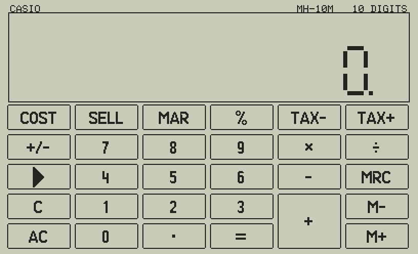

# MH-10M 47 — the Casio MH-10M desk calculator on the C47 / R47

`MH10M` turns the SwissMicros C47 / R47 into a **Casio MH-10M**: its 10-digit LCD with 7-segment digits,
the decimal point and the thousands marks, and **its keypad drawn on the screen** — each key you press on the
C47 shows the Casio key it is, inverted, until the next key. It calculates the way the Casio does: algebraic
entry, left to right, results cut to the 10 digits shown, the constant of `=`, the Casio's `%`, memory,
cost/sell/margin and tax.

## Keys

The Casio's top row (COST … TAX+) is on the **soft keys F1–F6**, its MRC M− M+ C AC and RATE SET on the
**C47's second row** (the six keys under the soft keys). The rest is where it is on the C47.

| C47 key | Casio key |
|---|---|
| 0–9, `.` | 0–9, `.` |
| `+` `−` `×` `÷` | `+` `−` `×` `÷` |
| ENTER | `=` |
| `+/−` | `+/−` |
| ← (backspace) | `▶` (the last digit keyed off) |
| F1 F2 F3 | COST SELL MAR |
| F4 F5 F6 | `%` TAX− TAX+ |
| second row, keys 1–6 | MRC M− M+ C AC RATE SET |
| x⇄y | OFF: the end |

At the end the screen is cleared, your stack and LASTx are as they were, and the display's value is put in X
(the stack lifted, as after a calculation).

## How it calculates (as the Casio)

- **Left to right, no precedence**: `2 + 3 × 4 =` gives 20.
- **10 digits, cut, not rounded**, and the Casio keeps only what it shows: `1 ÷ 3 = × 3 =` gives
  0.999999999. An 11th digit keyed is ignored.
- **The constant** (`=` again, or a new number and `=`): for `×` the **first** number is the constant
  (`3 × 5 = =` 45, then `7 =` 21); for `+ − ÷` the **second** (`10 ÷ 2 = =` 2.5, then `8 =` 4).
  `5 × =` squares, `5 + =` doubles.
- **%**: `a × b %` = ab/100, `a ÷ b %` = 100a/b, `a + b %` = a plus b % (1500 + 15 % = 1725), `a − b %`
  = a less b % (1275); alone, `b %` = b/100.
- **Memory**: M+ and M− finish the calculation first, then add or take away; MRC recalls, MRC twice clears.
  `M` shows when the memory is not 0. The memory is kept between runs (variable `MHMEM`).
- **COST, SELL, MAR** (margin on the selling price): key two, the third is worked out and shown —
  `1000 COST 25 MAR` gives the selling price 1333.333333; `1000 COST 1250 SELL` the margin 20.
  Pressed again with no new number, a key shows its value.
- **Tax**: TAX+ adds the tax (`1500 TAX+` at 8 % gives 1620), TAX− takes it out (`1080 TAX−` gives 1000);
  pressed twice, the tax itself (120, 80) with `TAX`. **Set the rate**: RATE SET (it shows the rate with
  `RATE SET`), key the rate, then RATE SET, `=` or TAX+. The rate is kept between runs (variable `MHTAX`).
- **E**: a result of 10 digits or more before the point (the display shows the result ÷ 10¹⁰, its first
  digits, as the Casio) or a division by 0. Only **C** (E off, the value kept to go on) and **AC** work.
- **C** clears the number being keyed (the operation stays); **AC** everything but the memory and the rate.
- The minus sign, M, E and the key indicators (COST, SELL, MAR, TAX+, TAX−, TAX, RATE, SET) are on the
  line above the digits, as on the Casio's display.

## Before the first run on a C47: please check the key codes

KEY? codes **F1–F6 = 11–16** (Logic 47), the digits and `+` (Almanac 47, Zones 47) are already checked on the
C47. The others are taken from the same row/column pattern and **not checked yet**: ENTER 41, x⇄y 42,
+/− 43, ← 45, ÷ × − 55 65 75, `.` 83, the second row 21–26. Almanac 47's `extras/KEYTEST.txt` (KT3) shows the
codes of 8 keys in R01–R08. If one differs, it is one number in `programs_rem/MH10M.txt` (its `LBL`, and the
list `"/11/12/…/"` of the keys used) and one in `python/layout.py`.

## Speed (in the simulator)

At Almanac 47's measured 0.17 ms a step: the start draws the keypad and the LCD in about 4 200 steps
(0.7 s); a key 650–1 700 steps (0.1–0.3 s; a digit keyed moves every digit on, so it redraws them all).
Only the cells, marks and indicators that change are drawn again; the key inverted is an XOR, drawn twice
to undo.

## Build and files

| | |
|---|---|
| `programs_rem/MH10M.txt` | the commented source (STRUCT, named labels) — edit this one |
| `programs/MH10M.txt`, `build/MH10M.txt` | the calculator program (to convert with rejig) |
| `build/forum/MH10M.p47u` | the same program as a commented rejig source: an `@` header (Index, Author, Version, Source, Tested, Input, Output), the steps indented, the comments after `;` (rejig drops them: no memory); written by the build (`tools/build_forum.py`, from Logic 47), checked by `tests/test_forum.py` |
| `listings/` | numbered steps with comments, the local labels |
| `python/layout.py` | the screen: the 7-segment glyphs, the LCD, the keypad, the indicators |
| `tools/build_mh10m.py` | the build: the drawing steps from `layout.py`, the STRUCT numbers, the labels |
| `python/c47sim.py`, `stdfont.py`, `tinyfont.py` | the C47 simulator and fonts, from Almanac 47 |
| `python/mh10msim.py` | runs MH10M in the simulator, writes `docs/*.png` |
| `tests/test_mh10m.py`, `tests/test_forum.py` | the tests |
| `tools/make_gif.py` | `docs/MH10M_tour.gif`, a short session key by key (Pillow) |

    python3 tools/build_mh10m.py     # programs/, build/, listings/, build/forum/MH10M.p47u
    python3 tests/test_mh10m.py      # worked examples, 400 random key sequences against a model, the screen
    python3 tests/test_forum.py      # the .p47u: the same steps as build/, no REM made of a comment
    python3 python/mh10msim.py       # docs/*.png
    python3 tools/make_gif.py        # docs/MH10M_tour.gif

Size: about 2 240 steps, 7.3 KB; 98 of the 100 local labels (00-10 the digits, the keys at their KEY?
codes); no IF, 6 DO, so within the original DM42's limit of 10 each. Commands: all already run on a C47 in
Almanac 47, Elements 47 or Zones 47 (STOS / RCLS, ATEXT, GRFNT, GRMOD, AGRAPH, SINT, KEY?, αPOS, STO IND,
RCL IND, STO×, R-CLR). Calculators: C47 / R47 with STRUCT, ATEXT and GRFNT (as Elements 47).
Not yet run on a real C47.

## Credits and licence

Victor Valdes, GNU GPL v3.0 or later (`LICENSE`, `NOTICE`). Written with the help of AI, used responsibly:
see `AI_ASSISTANCE.md`. Fonts: the C43/C47 firmware. Casio and MH-10M are trademarks of Casio Computer Co.,
Ltd.; SwissMicros, C47, R47 and DM42 of their owners. This project is not affiliated with or endorsed by them.
